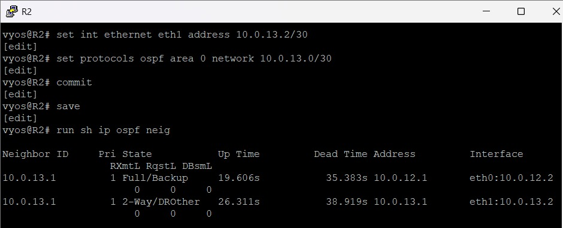
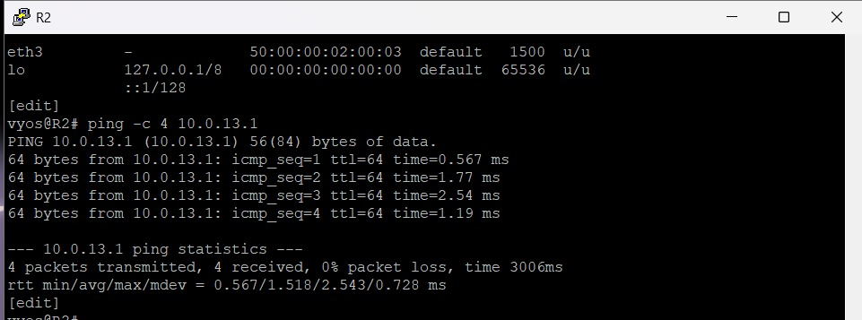
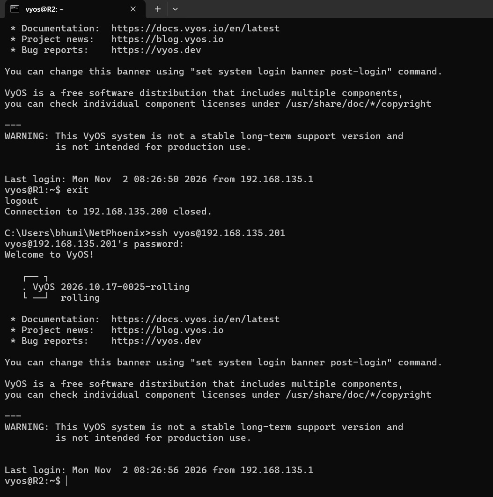
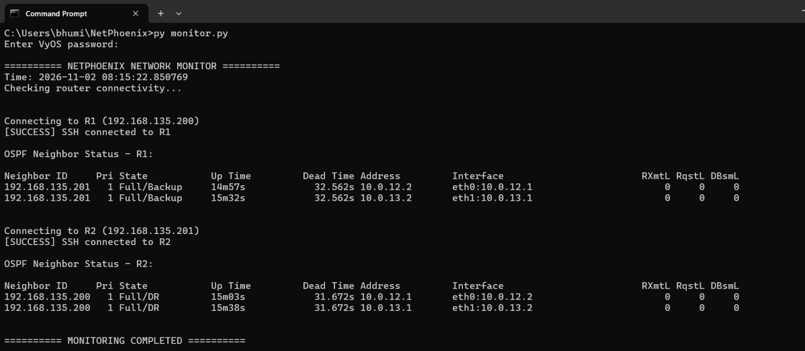
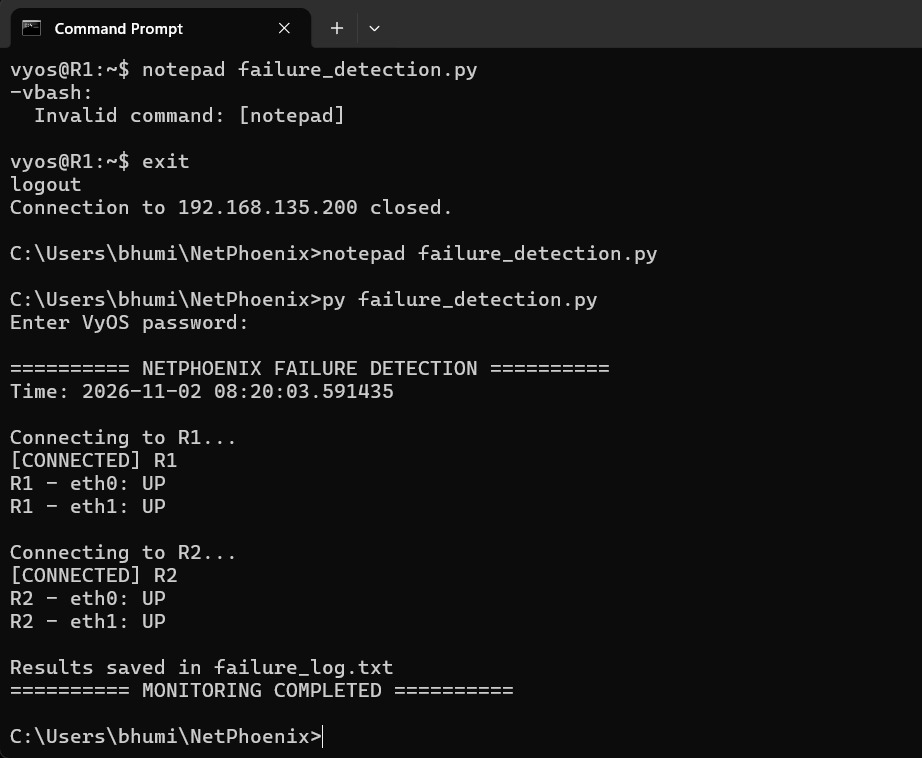
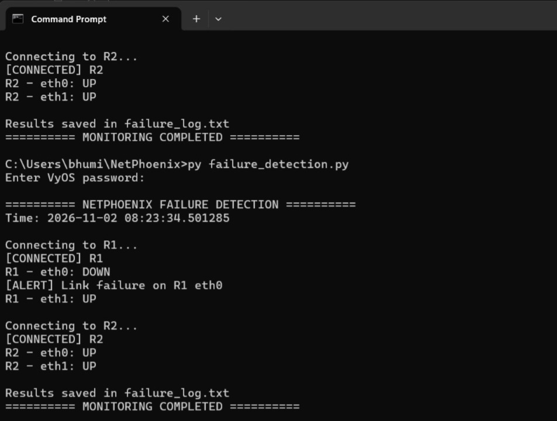
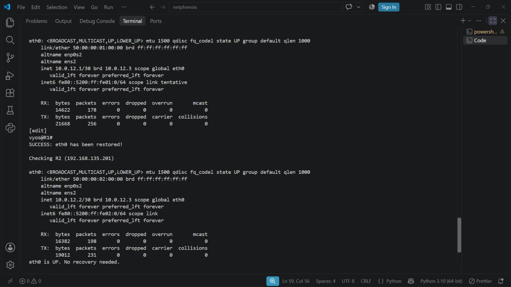
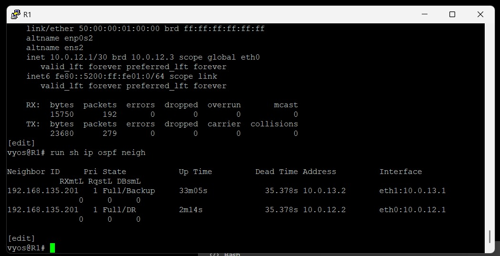

# NetPhoenix: An Automated Self-Healing Network for Fault Detection and Recovery

**Final-Year Major Project | B.Tech Computer Science and Engineering**

NetPhoenix is a group project focused on improving network reliability through redundancy, failure detection and network automation. The project uses virtualized VyOS routers in EVE-NG, OSPF routing and Python-based automation to monitor network conditions and identify link failures.

The network is designed with redundant paths so that communication can continue if one link becomes unavailable. Python and Netmiko are used to connect to the routers over SSH, collect network information, monitor interface status, detect failures and perform recovery actions.

The project is being developed and tested in a virtual environment using VMware Workstation Pro and EVE-NG. No physical networking hardware is required.

> **Current progress:** The virtual network, OSPF routing, SSH connectivity, Python-based monitoring, interface failure detection, failure logging and automated recovery have been implemented and tested. Further testing and Wireshark analysis are planned.

---

## 1. Project Overview

In a computer network, a link failure can interrupt communication if there is no alternative path available. Network administrators usually need to identify the problem and take corrective action.

NetPhoenix aims to reduce this manual effort by combining redundant network paths with Python-based monitoring and automation.

The project currently uses two VyOS routers, R1 and R2, connected through two Ethernet links. OSPF is configured to provide dynamic routing between them.

Python scripts using Netmiko connect to both routers through SSH. They collect router information, check interface status and identify failures. When a monitored interface is detected as DOWN, the recovery script can perform a recovery action and verify whether the interface has returned to the UP state.

## 2. Project Objectives

- Build a virtual network using EVE-NG and VyOS.
- Configure IP addressing and OSPF routing.
- Establish redundant links between routers.
- Simulate network link failures.
- Configure SSH access for remote router management.
- Use Python and Netmiko to monitor network devices.
- Identify interfaces in UP or DOWN states.
- Generate alerts and maintain failure logs.
- Implement automated recovery through Python.
- Verify connectivity and interface status after recovery.
- Analyse OSPF behaviour during failures using Wireshark.

## 3. Technologies Used

| Technology | Purpose |
|---|---|
| EVE-NG Community Edition | Virtual network topology and lab environment |
| VMware Workstation Pro | Running the EVE-NG virtual machine |
| VyOS | Router configuration and routing |
| IPv4 and subnetting | Interface addressing |
| OSPF | Dynamic routing and redundant paths |
| SSH / OpenSSH | Remote router access |
| Python 3 | Monitoring and automation scripts |
| Netmiko | Connecting to and managing VyOS routers through SSH |
| Wireshark | Packet capture and planned OSPF analysis |
| Windows Command Prompt | Running Python scripts and SSH commands |
| Git and GitHub | Version control and project documentation |

## 4. Network Topology

The lab contains two VyOS routers, R1 and R2, connected through two independent Ethernet links.


*Figure 1: Virtual network topology created in EVE-NG.*

### IP Addressing

| Router | Interface | IP Address |
|---|---|---|
| R1 | eth0 | 10.0.12.1/30 |
| R2 | eth0 | 10.0.12.2/30 |
| R1 | eth1 | 10.0.13.1/30 |
| R2 | eth1 | 10.0.13.2/30 |

The two links use separate `/30` subnets.

### Management Network

A separate management network using EVE-NG Cloud0 was added to provide access to the routers from Windows.

| Router | Management Interface | IP Address |
|---|---|---|
| R1 | eth2 | 192.168.135.200 |
| R2 | eth2 | 192.168.135.201 |

SSH was enabled on both routers, and remote login was successfully tested from Windows.

## 5. OSPF Configuration and Connectivity Testing

OSPF was configured on both routers in Area 0 using the two connected link subnets.

The following network statements were used:

```bash
set protocols ospf area 0 network 10.0.12.0/30
set protocols ospf area 0 network 10.0.13.0/30
```

Configuration was committed and saved. OSPF neighbor information was checked using:

```bash
run show ip ospf neighbor
```



*Figure 2: OSPF neighbor information before the failure experiment.*

Ping tests were also performed to verify communication between the routers.



*Figure 3: Initial connectivity test.*

## 6. SSH Configuration and Remote Access

SSH was enabled on both VyOS routers to allow remote management.

The SSH service was configured using:

```bash
set service ssh port 22
commit
save
```

Connectivity was tested from Windows Command Prompt using:

```cmd
ssh vyos@192.168.135.200
ssh vyos@192.168.135.201
```

Both routers accepted SSH connections successfully.



*Figure 4: Successful SSH login to R1 and R2 from Windows.*

## 7. Python and Netmiko Implementation

After establishing SSH access, Python and Netmiko were used to communicate with the routers.

Netmiko allows the Python scripts to establish SSH sessions and execute commands on the VyOS devices.

The project includes three main Python scripts.

### 7.1 Router Monitoring Script

File: `scripts/monitor.py`

The first script connects to both routers and retrieves their OSPF neighbor information.

The script:

- Establishes SSH connections to R1 and R2.
- Uses Netmiko to execute router commands.
- Retrieves OSPF neighbor information.
- Displays the output in Windows Command Prompt.
- Disconnects after collecting the information.



*Figure 5: Python successfully connecting to both routers and retrieving OSPF neighbor information.*

### 7.2 Interface Failure Detection Script

File: `scripts/failure_detection.py`

The second script monitors the Ethernet interfaces on both routers.

The monitored interfaces are:

- R1: eth0 and eth1
- R2: eth0 and eth1

The script connects to each router using Netmiko, retrieves interface information and checks whether the interface state is UP or DOWN.

If an interface is detected as DOWN, an alert is displayed. The script also records monitoring results and detected failures in a log file.



*Figure 6: Python interface monitoring when the network links are operational.*



*Figure 7: Python detecting a failed interface and generating an alert.*

### 7.3 NetPhoenix Automated Recovery Script

File: `scripts/netphoenix_test.py`

The third script brings together router monitoring, failure detection and automated recovery.

It connects to both routers through SSH and checks the status of their interfaces.

When R1's eth0 interface is detected as DOWN, the script:

1. Identifies the affected interface.
2. Generates a failure alert.
3. Starts the recovery process.
4. Connects to the router and removes the interface's disabled configuration.
5. Commits the configuration change.
6. Checks the interface status again.
7. Reports whether the interface has been restored.

The script also checks R2 and confirms its interface status.



*Figure 8: Python performing the automated recovery action on R1.*



*Figure 9: Verification showing that R1's eth0 interface has returned to the UP state.*

**Note:** The recovery experiment was performed in the virtual lab by manually disabling an interface. The Python script then detected the disabled interface and restored its configuration. This demonstrates the recovery process in the current test environment.

## 8. Manual Failure and Alternate-Path Testing

A link-failure experiment was performed to check whether communication could continue when one of the two links was disabled.

The test was carried out as follows:

1. Verified that both links were operational.
2. Disabled R1's eth0 interface.
3. Checked the interface status.
4. Confirmed that the alternate link was still available.
5. Tested connectivity through the alternate link.
6. Restored the original interface.

The alternate-path connectivity test was performed from R2 using:

```bash
run ping 10.0.13.1
```

The test produced the following result:

- Packets transmitted: 9
- Packets received: 9
- Packet loss: 0%


*Figure 10: Manual link-failure experiment in the VyOS router.*

The test confirmed that the alternate link could carry traffic while R1 eth0 was disabled. OSPF handled routing over the available path.

## 9. Failure Logging

The project also maintains logs of monitoring and recovery activities.

The log file is stored at:

```text
logs/netphoenix.log
```

The logs help keep track of events such as:

- Starting the NetPhoenix monitoring process.
- Connecting to R1 and R2.
- Checking interface status.
- Detecting a failed interface.
- Starting the recovery process.
- Verifying the interface after recovery.
- Completing the monitoring process.


*Figure 11: NetPhoenix logging output showing monitoring and recovery events.*

## 10. Troubleshooting and Issues Faced

Several configuration and connectivity issues were encountered during development.

### 10.1 OSPF Neighbor and Routing Issues

During initial configuration, OSPF neighbor formation and routing status required troubleshooting.

The following checks were performed:

- Verified interface IP addresses.
- Checked OSPF network statements.
- Inspected router IDs and neighbor information.
- Rechecked connectivity after configuration changes.

### 10.2 Interface and Connectivity Testing

Ping tests were initially used to verify communication between the routers.

During the failure experiment, the original link was disabled and the alternate path was tested separately. This helped confirm that the remaining link could carry traffic.

### 10.3 EVE-NG Console Access

The router consoles initially required additional Windows console-client configuration. The EVE-NG console client was installed and configured to access the VyOS terminals.

### 10.4 Management Network Connectivity

The Cloud0 management connection initially caused problems.

Troubleshooting included:

- Checking the EVE-NG management bridge.
- Inspecting the bridge's connected interfaces.
- Checking router interface addresses.
- Inspecting the ARP table from Windows.
- Capturing ARP requests using `tcpdump`.
- Checking connectivity between Windows and the router management interfaces.

After configuring the management addresses and checking the network connection, Windows was able to ping both routers and establish SSH sessions.

### 10.5 Netmiko Connection Error

The first Python monitoring script produced an error because an unsupported `name` parameter was passed to Netmiko.

The router information was separated from the connection parameters, and the script was corrected.

After the change, Python successfully connected to both routers and retrieved OSPF neighbor information.

### 10.6 Interface Status Detection

The initial failure detection script returned UNKNOWN for all interfaces because its output parsing did not correctly recognise the VyOS interface response.

The script was updated to search the complete command output for the interface state.

After this correction, it successfully identified interfaces as UP and detected R1 eth0 as DOWN during the failure experiment.

### 10.7 Automated Recovery Testing

During the recovery stage, the Python script was tested with an interface that had been manually disabled.

The script detected the DOWN state, executed the recovery configuration through Netmiko and checked the interface again.

The interface was successfully restored to the UP state.

## 11. Current Implementation Status

| Component | Status |
|---|---|
| EVE-NG virtual lab | Completed |
| Two VyOS routers | Completed |
| Redundant Ethernet links | Completed |
| IPv4 addressing | Completed |
| OSPF Area 0 configuration | Completed |
| SSH access to both routers | Completed |
| Python and Netmiko setup | Completed |
| OSPF information collection | Completed |
| Four-interface monitoring | Completed |
| UP/DOWN failure detection | Completed |
| Failure alerts | Completed |
| Failure event logging | Completed |
| Manual failure simulation | Tested |
| Alternate-path connectivity | Tested successfully |
| Python-controlled interface recovery | Implemented and tested |
| Recovery verification | Tested successfully |
| Continuous monitoring improvements | Further work |
| Wireshark packet analysis | Pending |
| Recovery-time and performance evaluation | Pending |

## 12. Work Planned

The next stage of development will focus on further testing and analysing the network.

### Monitoring and Recovery Improvements

- Improve continuous Python-based monitoring.
- Test different interface-failure scenarios.
- Check the reliability of failure detection and recovery.
- Record recovery events and results.
- Measure recovery time and packet loss.

### Wireshark Analysis

- Capture normal OSPF traffic.
- Capture traffic during a link failure.
- Observe OSPF convergence.
- Capture traffic after link restoration.
- Compare packet behaviour during the experiments.

### Final Testing and Documentation

- Repeat link-failure experiments.
- Evaluate the recovery process.
- Document project limitations.
- Prepare final observations and results.

## 13. Repository Structure

```text
NetPhoenix/
│
├── README.md
│
├── docs/
│   ├── NetPhoenix_Progress1.pdf
│   └── NetPhoenix_Progress2.pdf
│
├── logs/
│   └── netphoenix.log
│
├── screenshots/
│   ├── net-topology.png
│   │
│   ├── progress-report-1/
│   │   ├── ospf-neighbors-before-failover.png
│   │   ├── ospf-neighbors-after-failover.png
│   │   ├── ping-before-failover.png
│   │   └── ping-during-failover.png
│   │
│   ├── progress-report-2/
│   │   ├── netmiko-both-routers.jpeg
│   │   ├── normal-interface-monitoring.jpeg
│   │   ├── python-failure-detection.jpeg
│   │   ├── alternate-path-ping.jpeg
│   │   └── ssh-connectivity-r1-r2.jpeg
│   │
│   └── progress-report-3/
│       ├── automated-recovery.jpeg
│       ├── failure-detection.jpeg
│       ├── logging-output.jpeg
│       ├── manual-failure-test.jpeg
│       └── recovery-verification.jpeg
│
└── scripts/
    ├── failure_detection.py
    ├── monitor.py
    └── netphoenix_test.py
```

## 14. Conclusion

The development of NetPhoenix has established a working virtual network with two VyOS routers, redundant links and OSPF routing.

SSH connectivity and Python-based router monitoring have also been implemented. Using Netmiko, the scripts can connect to both routers, retrieve OSPF information and monitor interface status.

The project has progressed from basic network configuration to failure detection, logging and automated recovery. During testing, the Python script successfully detected a disabled interface, performed the recovery action and verified that the interface returned to the UP state. Manual failure testing also confirmed that communication could continue through the alternate link.

The next stage will focus on Wireshark analysis, additional testing and evaluating the performance of the recovery process.

---

**Project:** NetPhoenix – An Automated Self-Healing Network for Fault Detection and Recovery  
**Project Type:** Final-Year Major Project (Group Project)  
**Domain:** Computer Networks and Network Automation  
**Repository:** [GitHub – NetPhoenix](https://github.com/gulpchronics/NetPhoenix)

*This repository will be updated as implementation, testing and documentation continue.*
