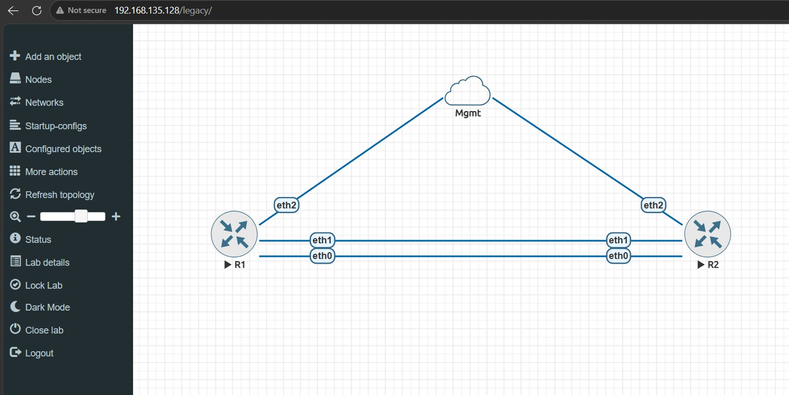
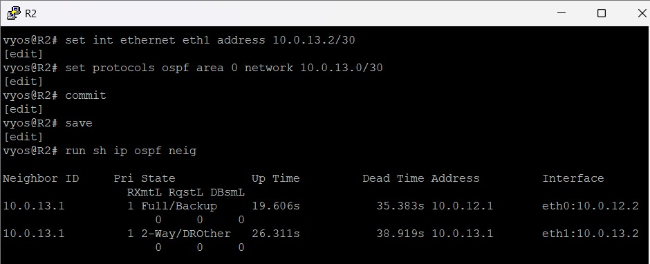
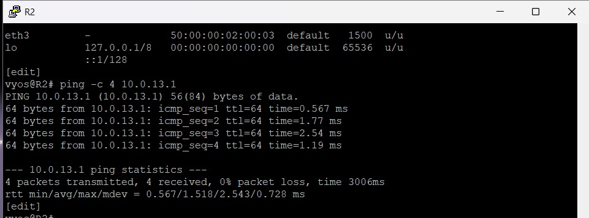
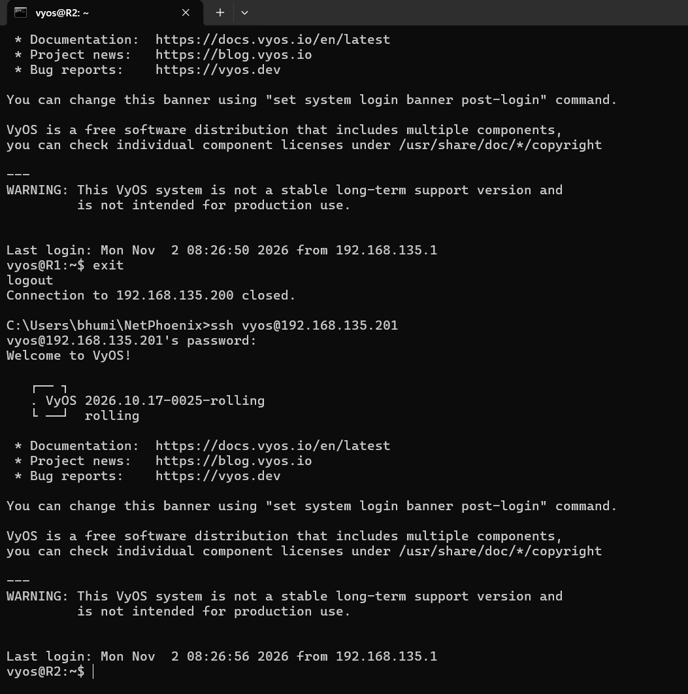
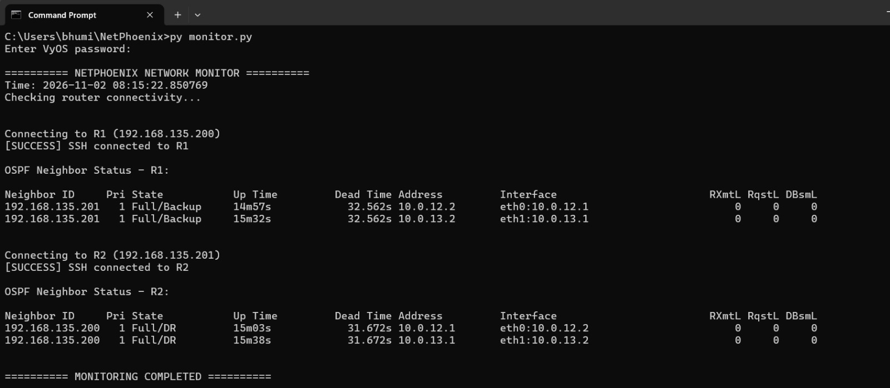
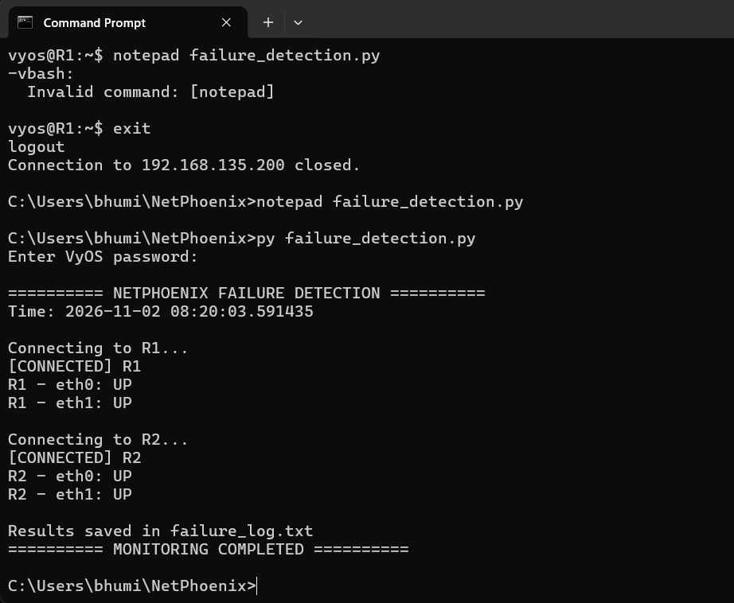
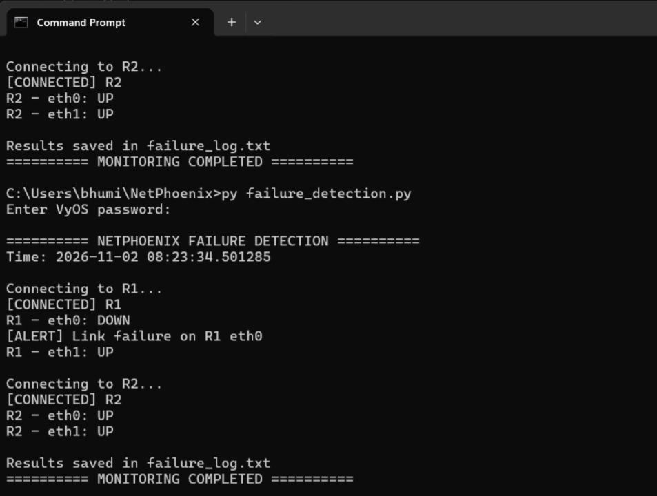
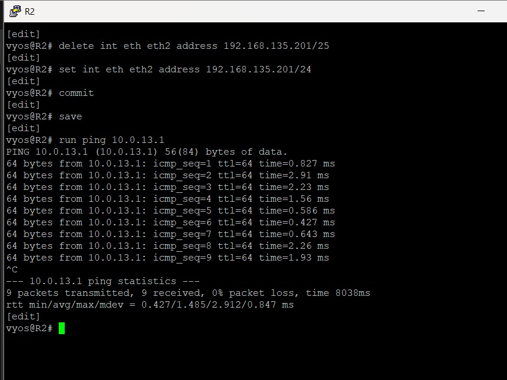

# NetPhoenix: An Automated Self-Healing Network for Fault Detection and Recovery

**Final-Year Major Project | B.Tech Computer Science and Engineering**

NetPhoenix is a group project focused on improving network reliability through redundancy, failure detection and network automation. The project uses virtualized VyOS routers in EVE-NG, OSPF routing and Python-based automation to monitor network conditions and identify link failures.

The network is designed with redundant paths so that communication can continue if one link becomes unavailable. Python and Netmiko are used to connect to the routers over SSH, collect OSPF information, monitor interface status and record detected failures.

The project is being developed and tested in a virtual environment using VMware Workstation Pro and EVE-NG. No physical networking hardware is required.

> **Current progress:** Virtual network implementation, OSPF routing, SSH connectivity, Python-based monitoring, interface failure detection and failure logging have been implemented and tested. Automated recovery and Wireshark analysis are the next development stages.

---

## 1. Project Overview

In a computer network, a link failure can interrupt communication if there is no alternative path available. Network administrators usually need to identify the problem and take corrective action.

NetPhoenix aims to reduce this manual effort by combining redundant network paths with Python-based monitoring and automation.

The project currently uses two VyOS routers connected through two Ethernet links. OSPF is configured to provide dynamic routing between them. Python scripts using Netmiko connect to both routers, retrieve routing information and check the status of their interfaces.

The current implementation can detect a failed interface and generate an alert. OSPF handles routing changes, while Python records the failure. Python-controlled recovery is planned for the next stage.

## 2. Project Objectives

- Build a virtual network using EVE-NG and VyOS.
- Configure IP addressing and OSPF routing.
- Establish redundant links between routers.
- Simulate network link failures.
- Configure SSH access for remote router management.
- Use Python and Netmiko to monitor network devices.
- Automatically identify interfaces in UP or DOWN states.
- Generate alerts and maintain failure logs.
- Implement controlled automated recovery.
- Analyse OSPF behaviour during failures using Wireshark.

## 3. Technologies Used

| Technology | Purpose |
|---|---|
| EVE-NG Community Edition | Virtual network topology and lab environment |
| VMware Workstation Pro | Running the EVE-NG virtual machine |
| VyOS | Router configuration and routing |
| IPv4 and subnetting | Interface addressing |
| OSPF | Dynamic routing and redundant paths |
| SSH / OpenSSH | Remote router access |
| Python 3 | Monitoring and automation scripts |
| Netmiko | Connecting to and managing VyOS routers through SSH |
| Wireshark | Planned packet capture and OSPF analysis |
| Windows Command Prompt | Running Python scripts and SSH commands |
| Git and GitHub | Version control and project documentation |

## 4. Network Topology

The current lab contains two VyOS routers, R1 and R2, connected through two independent Ethernet links.



*Figure 1: Virtual network topology created in EVE-NG.*

### IP Addressing

| Router | Interface | IP Address |
|---|---|---|
| R1 | eth0 | 10.0.12.1/30 |
| R2 | eth0 | 10.0.12.2/30 |
| R1 | eth1 | 10.0.13.1/30 |
| R2 | eth1 | 10.0.13.2/30 |

The two links use separate `/30` subnets.

### Management Network

A separate management network using EVE-NG Cloud0 was added to provide access to the routers from Windows.

| Router | Management Interface | IP Address |
|---|---|---|
| R1 | eth2 | 192.168.135.200 |
| R2 | eth2 | 192.168.135.201 |

SSH was enabled on both routers, and remote login was successfully tested from Windows.

## 5. OSPF Configuration and Connectivity Testing

OSPF was configured on both routers in Area 0 using the two connected link subnets.

The following network statements were used:

```bash
set protocols ospf area 0 network 10.0.12.0/30
set protocols ospf area 0 network 10.0.13.0/30
```

Configuration was committed and saved. OSPF neighbor information was checked using:

```bash
run show ip ospf neighbor
```



*Figure 2: OSPF neighbor information before the failure experiment.*

Ping tests were also performed to verify communication between the routers.



*Figure 3: Initial connectivity test.*

## 6. SSH Configuration and Remote Access

SSH was enabled on both VyOS routers to allow remote management.

The SSH service was configured using:

```bash
set service ssh port 22
commit
save
```

Connectivity was tested from Windows Command Prompt using:

```cmd
ssh vyos@192.168.135.200
ssh vyos@192.168.135.201
```

Both routers accepted SSH connections successfully.



*Figure 4: Successful SSH login to R1 and R2 from Windows.*

## 7. Python and Netmiko Implementation

After establishing SSH access, Python and Netmiko were used to communicate with the routers.

Netmiko allows the Python scripts to establish SSH sessions and execute commands on the VyOS devices.

Two scripts have been developed so far.

### 7.1 Router Monitoring Script

File: `scripts/monitor.py`

The first script connects to both routers and retrieves their OSPF neighbor information.

The script:

- Establishes SSH connections to R1 and R2.
- Uses Netmiko to execute router commands.
- Retrieves OSPF neighbor information.
- Displays the output in Windows Command Prompt.
- Disconnects after collecting the information.



*Figure 5: Python successfully connecting to both routers and retrieving OSPF neighbor information.*

### 7.2 Interface Failure Detection Script

File: `scripts/failure_detection.py`

The second script monitors the Ethernet interfaces on both routers.

The monitored interfaces are:

- R1: eth0 and eth1
- R2: eth0 and eth1

The script connects to each router using Netmiko, retrieves interface information and checks whether the interface state is UP or DOWN.

If an interface is detected as DOWN, an alert is displayed.

The script also records monitoring results and detected failures in `failure_log.txt`.

**Normal monitoring result:**

All four interfaces were detected as UP during normal operation.



*Figure 6: Python interface monitoring when both network links are operational.*

**Failure detection result:**

During the failure experiment, R1's eth0 interface was disabled manually.

The Python script detected the interface as DOWN and generated an alert. The remaining interfaces continued to show UP.



*Figure 7: Python detecting the failed R1 eth0 interface and generating an alert.*

### 7.3 Failure Logging

The monitoring script saves results in:

```text
failure_log.txt
```

The log records interface status and detected failure messages.

This provides a record of the monitoring and testing process.

## 8. Manual Failure and Alternate-Path Testing

A link-failure experiment was performed to check whether communication could continue when one of the two links was disabled.

The test was carried out as follows:

1. Verified that both links were operational.
2. Disabled R1's eth0 interface.
3. Ran the Python failure detection script.
4. Confirmed that R1 eth0 was detected as DOWN.
5. Checked that R1 eth1 and both R2 interfaces remained UP.
6. Tested connectivity through the alternate link.
7. Restored the original interface.

The alternate-path connectivity test was performed from R2 using:

```bash
run ping 10.0.13.1
```

The test produced the following result:

- Packets transmitted: 9
- Packets received: 9
- Packet loss: 0%



*Figure 8: Successful ping through the alternate link while R1 eth0 was disabled.*

The original interface was subsequently restored, and all four interfaces were checked again.

**Note:** The failure was introduced manually. Python detected and logged the failure, while OSPF handled routing over the available path. Python-controlled recovery has not yet been implemented.

## 9. Troubleshooting and Issues Faced

Several configuration and connectivity issues were encountered during development.

### 9.1 OSPF Neighbor and Routing Issues

During initial configuration, OSPF neighbor formation and routing status required troubleshooting.

The following checks were performed:

- Verified interface IP addresses.
- Checked OSPF network statements.
- Inspected router IDs and neighbor information.
- Rechecked connectivity after configuration changes.

### 9.2 Interface and Connectivity Testing

Ping tests were initially used to verify communication between the routers.

During the failure experiment, the original link was disabled and the alternate path was tested separately. This helped confirm that the remaining link could carry traffic.

### 9.3 EVE-NG Console Access

The router consoles initially required additional Windows console-client configuration. The EVE-NG console client was installed and configured to access the VyOS terminals.

### 9.4 Management Network Connectivity

The Cloud0 management connection initially caused problems.

Troubleshooting included:

- Checking the EVE-NG `pnet0` bridge.
- Inspecting the bridge's connected interfaces.
- Checking router interface addresses.
- Inspecting the ARP table from Windows.
- Capturing ARP requests using `tcpdump`.
- Checking connectivity between Windows and the router management interfaces.

After configuring the management addresses and checking the network connection, Windows was able to ping both routers and establish SSH sessions.

### 9.5 Netmiko Connection Error

The first Python monitoring script produced an error because an unsupported `name` parameter was passed to Netmiko.

The router information was separated from the connection parameters, and the script was corrected.

After the change, Python successfully connected to both routers and retrieved OSPF neighbor information.

### 9.6 Interface Status Detection

The initial failure detection script returned UNKNOWN for all interfaces because its output parsing did not correctly recognise the VyOS interface response.

The script was updated to search the complete command output for the interface state.

After this correction, it successfully identified all four interfaces as UP and detected R1 eth0 as DOWN during the failure experiment.

## 10. Current Implementation Status

| Component | Status |
|---|---|
| EVE-NG virtual lab | Completed |
| Two VyOS routers | Completed |
| Redundant Ethernet links | Completed |
| IPv4 addressing | Completed |
| OSPF Area 0 configuration | Completed |
| SSH access to both routers | Completed |
| Python and Netmiko setup | Completed |
| Automated OSPF information collection | Completed |
| Four-interface monitoring | Completed |
| UP/DOWN failure detection | Completed |
| Failure alerts | Completed |
| Failure event logging | Completed |
| Manual failure simulation | Tested |
| Alternate-path connectivity | Tested successfully |
| Continuous background monitoring | Pending |
| Python-controlled automated recovery | Pending |
| Wireshark packet analysis | Pending |
| Recovery and performance evaluation | Pending |

## 11. Work Planned

The next stage of development will focus on completing the self-healing functionality.

### Automated Recovery

- Develop continuous Python-based monitoring.
- Improve failure detection with repeated checks.
- Identify the affected router and interface.
- Implement controlled recovery actions through Netmiko.
- Verify connectivity after recovery.
- Record recovery events and results.

### Wireshark Analysis

- Capture normal OSPF traffic.
- Capture traffic during a link failure.
- Observe OSPF convergence.
- Capture traffic after link restoration.
- Compare packet behaviour during the experiments.

### Further Testing

- Repeat link-failure experiments.
- Check the reliability of detection and recovery.
- Measure recovery time and packet loss.
- Document limitations and final observations.

## 12. Repository Structure

```text
NetPhoenix/
│
├── README.md
│
├── scripts/
│   ├── monitor.py
│   └── failure_detection.py
│
├── docs/
│   └── NetPhoenix_Progress1.pdf
│
└── screenshots/
    │
    ├── net-topology.png
    │
    ├── progress-report-1/
    │   ├── ospf-neighbors-before-failover.png
    │   ├── ospf-neighbors-after-failover.png
    │   ├── ping-before-failover.png
    │   └── ping-during-failover.png
    │
    └── progress-report-2/
        ├── netmiko-both-routers.jpeg
        ├── normal-interface-monitoring.jpeg
        ├── python-failure-detection.jpeg
        ├── alternate-path-ping.jpeg
        └── ssh-connectivity-r1-r2.jpeg
```

## 13. Conclusion

The initial implementation of NetPhoenix has established a working virtual network with two VyOS routers, redundant links and OSPF routing.

SSH connectivity and Python-based router monitoring have also been implemented. Using Netmiko, the scripts can connect to both routers, retrieve OSPF information and monitor interface status. A manual link-failure experiment confirmed that the Python script could detect and log the failed interface while connectivity continued through the alternate link.

The project is now moving towards continuous monitoring and Python-controlled automated recovery. Wireshark will also be used in the next stage to study network traffic and OSPF behaviour during failure and recovery experiments.

---

**Project:** NetPhoenix – An Automated Self-Healing Network for Fault Detection and Recovery  
**Project Type:** Final-Year Major Project (Group Project)  
**Domain:** Computer Networks and Network Automation  
**Repository:** [GitHub – NetPhoenix](https://github.com/gulpchronics/NetPhoenix)

*This repository will be updated as implementation, testing and documentation continue.*
