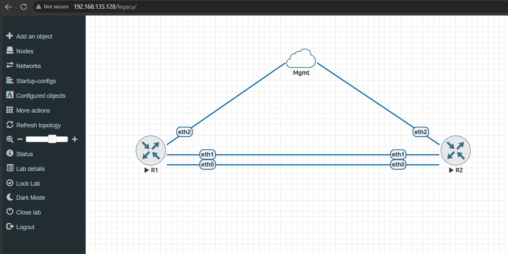
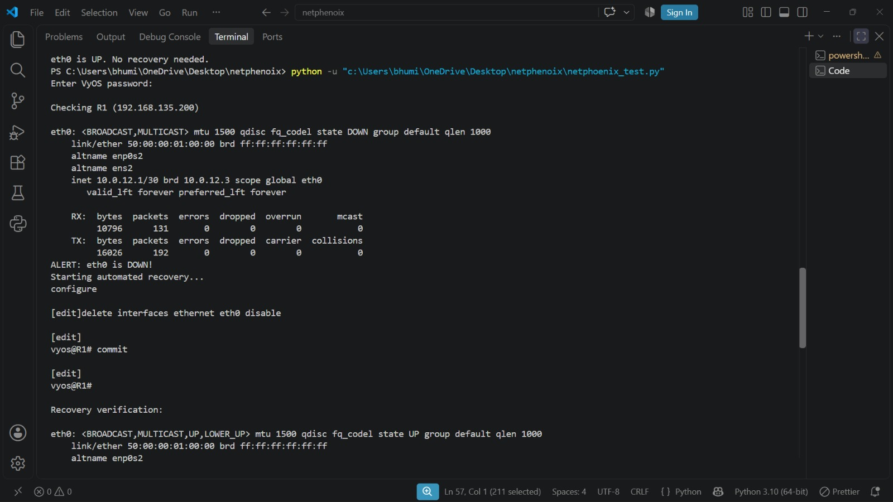
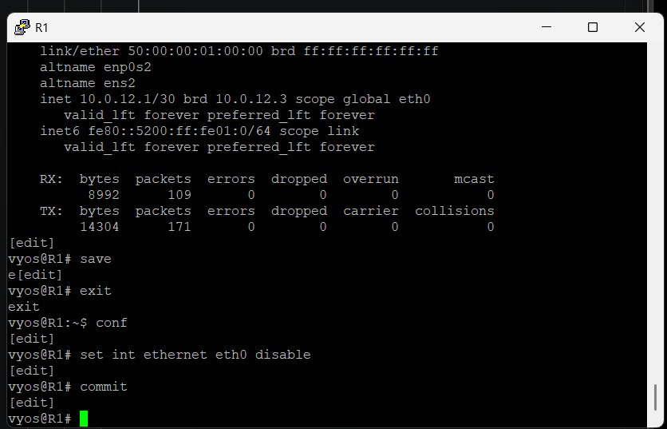
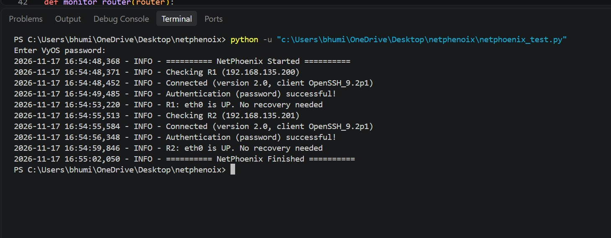

# NetPhoenix – An Automated Self-Healing Network

NetPhoenix is our final-year major project. The main idea is to build a network that can detect link failures and take recovery action with the help of Python automation.

We are using virtual VyOS routers in EVE-NG, OSPF for routing, and Python with Netmiko to communicate with the routers. The project is developed in a virtual environment, so no physical networking devices are required.

## About the Project

In a normal network, a link failure can interrupt communication. NetPhoenix uses two routers connected through redundant links so that another path is available if one link goes down.

Python connects to the routers through SSH and checks their interface status. When a failure is detected, the script generates an alert and performs a recovery action by restoring the affected interface. It then checks whether the interface is UP again.

OSPF is used to manage routing between the routers, while Python handles monitoring, failure detection and the recovery process.

## Technologies Used

- **EVE-NG:** Creating and running the virtual network.
- **VMware Workstation:** Running the EVE-NG virtual machine.
- **VyOS:** Router configuration.
- **OSPF:** Dynamic routing and redundant paths.
- **Python:** Monitoring and automation.
- **Netmiko:** Connecting to VyOS routers through SSH.
- **Wireshark:** Planned network traffic analysis.
- **GitHub:** Storing project files, scripts and documentation.

## Network Topology

The current topology contains two VyOS routers, R1 and R2, connected through two Ethernet links.



### IP Addressing

| Router | Interface | IP Address |
|---|---|---|
| R1 | eth0 | 10.0.12.1/30 |
| R2 | eth0 | 10.0.12.2/30 |
| R1 | eth1 | 10.0.13.1/30 |
| R2 | eth1 | 10.0.13.2/30 |

A separate management network is also configured so that Python scripts running on Windows can access both routers through SSH.

## What Has Been Implemented

So far, we have completed the following:

- Created the virtual network using EVE-NG.
- Installed and configured two VyOS routers.
- Connected the routers through two redundant links.
- Configured IP addresses and OSPF Area 0.
- Enabled SSH access on both routers.
- Connected Python to both routers using Netmiko.
- Developed scripts to collect OSPF information and monitor interfaces.
- Implemented interface failure detection and logging.
- Tested the network by manually disabling a link.
- Implemented Python-based recovery to restore the disabled interface.
- Verified that the interface returned to the UP state after recovery.

## Failure Detection and Recovery

We tested the project by disabling the `eth0` interface on R1.

The Python script detected that the interface was DOWN and displayed an alert. It then connected to the router configuration and removed the interface's disabled setting.

After committing the change, the script checked the interface again and confirmed that it was UP.

OSPF manages the routing between the available paths, while the Python script handles the detection and recovery action.

### Screenshots – Report 3

**Failure detection**



**Automated recovery**


**Recovery verification**


**Manual failure test**



**Logging output**



## Project Structure

```text
NetPhoenix/
│
├── README.md
│
├── docs/
│   ├── NetPhoenix_Progress1.pdf
│   └── NetPhoenix_Progress2.pdf
│
├── logs/
│   └── netphoenix.log
│
├── scripts/
│   ├── monitor.py
│   ├── failure_detection.py
│   └── netphoenix_test.py
│
└── screenshots/
    ├── net-topology.png
    │
    ├── progress-report-1/
    │
    ├── progress-report-2/
    │
    └── progress-report-3/
        ├── automated-recovery.jpeg
        ├── failure-detection.jpeg
        ├── logging-output.jpeg
        ├── manual-failure-test.jpeg
        └── recovery-verification.jpeg
```

## Current Progress and Next Steps

The basic monitoring, failure detection and automated recovery workflow has been implemented and tested.

The remaining work includes:

- Testing recovery in repeated failure scenarios.
- Capturing network traffic using Wireshark.
- Studying OSPF behaviour during link failure and recovery.
- Measuring recovery time and packet loss.
- Completing the final project documentation.

## Project Details

- **Project Name:** NetPhoenix
- **Project Type:** Final-Year Major Project
- **Domain:** Computer Networks and Network Automation
- **Environment:** EVE-NG, VMware Workstation and Windows
- **Repository:** [NetPhoenix on GitHub](https://github.com/gulpchronics/NetPhoenix)

This project is still under development, and we will keep updating the repository as we complete more testing and documentation.
