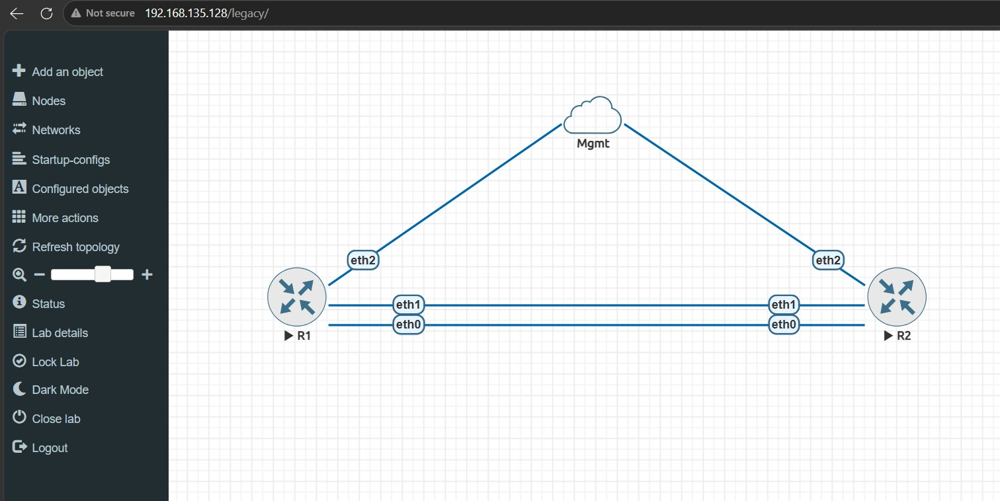
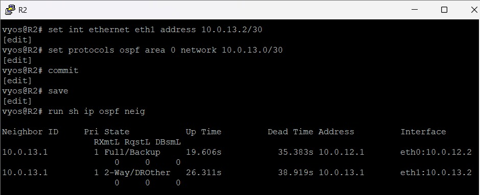
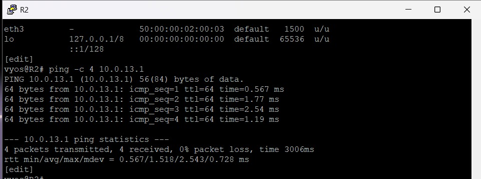
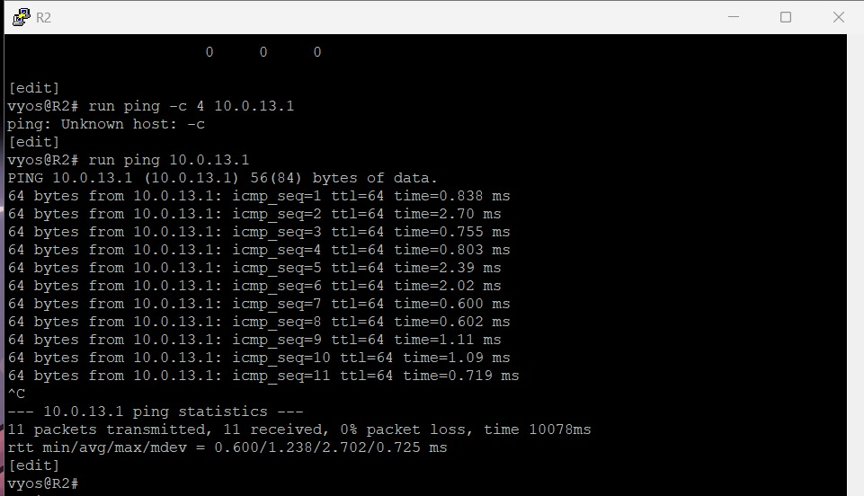
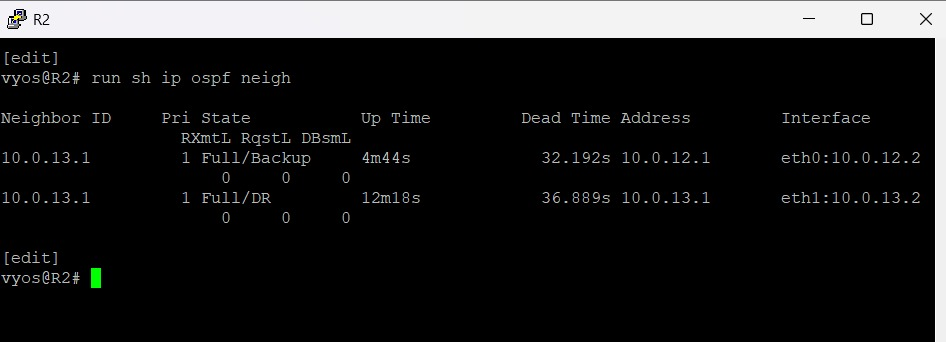

# NetPhoenix: An Automated Self-Healing Network for Fault Detection and Recovery

**Final-Year Major Project | B.Tech Computer Science and Engineering**

NetPhoenix is a network automation project that aims to detect predefined network failures, identify affected paths, and verify or initiate recovery using Python-based automation. The project uses virtualized VyOS routers in EVE-NG, OSPF routing, SSH, Netmiko, and Wireshark to study network resilience and reduce the need for manual intervention.

The project is being developed as a team effort. The initial virtual network has been implemented, OSPF has been configured, and a manual link-failure experiment has been performed. The next stage is to integrate Python automation, test failure detection and recovery, and analyze routing behavior during failures.

> **Current status:** Network topology, IP addressing, OSPF configuration, and initial manual failover testing completed. Python-based failure detection and automated recovery are still under development.

---

## 1. Project Overview

### Problem Statement

Computer networks are expected to remain available even when individual links or devices fail. In a network without an alternative path, a link failure can interrupt communication until an administrator identifies and fixes the problem.

Dynamic routing protocols such as OSPF can recalculate routes when the network topology changes. However, monitoring the network, identifying failures, collecting evidence, and performing additional recovery actions can still require administrative effort.

NetPhoenix aims to combine network redundancy with Python-based automation to make failure detection and recovery verification more systematic.

### Proposed Solution

The project uses two virtual VyOS routers connected through redundant Ethernet links. OSPF is configured so that the routers can learn routes and respond to topology changes.

A Python automation component using Netmiko is planned to communicate with the routers over SSH, monitor network health, detect predefined failures, and record the results. Where required, it will perform controlled recovery actions and verify connectivity afterward.

Wireshark will be used to examine network traffic and OSPF behavior during failure and recovery experiments.

### Main Objectives

- Build a virtual network using EVE-NG and VyOS.
- Configure IP addressing and OSPF routing.
- Provide redundant paths between routers.
- Simulate link failures and test connectivity through an alternate path.
- Develop Python-based monitoring using Netmiko and SSH.
- Detect predefined link or router-connectivity failures.
- Verify recovery and record test results.
- Analyze network traffic and OSPF convergence using Wireshark.
- Document the implementation, troubleshooting, and experimental results.

## 2. Project Architecture

The proposed system has three main parts:

1. **Network layer:** VyOS routers, Ethernet links, IP addressing, and OSPF provide routing and redundancy.
2. **Automation layer:** Python and Netmiko will monitor the routers, detect predefined failures, and perform or verify appropriate recovery actions.
3. **Analysis layer:** Wireshark will be used to examine traffic and routing behavior before, during, and after a failure.

The current implementation focuses on the network layer. The automation and packet-analysis layers are planned for the next stages.

### Proposed Workflow

```text
        Virtual Network in EVE-NG
                    |
          VyOS Routers and Links
                    |
             OSPF Routing
                    |
          Simulate Network Failure
                    |
          Python + Netmiko
          (Planned automation)
                    |
          Detect and Record Failure
                    |
          Verify Alternate-Path
               Connectivity
                    |
          Wireshark Analysis
```

The diagram describes the intended workflow, not a claim that the complete automation is already running. OSPF handles dynamic route calculation; the planned Python component will provide monitoring, failure detection, logging, and controlled recovery verification.

## 3. Technologies and Tools

| Technology | Purpose |
|---|---|
| EVE-NG Community Edition | Creating and running the virtual network topology |
| VMware Workstation Pro | Running the EVE-NG virtual machine |
| VyOS | Virtual routers, interface configuration, and routing |
| IPv4 and subnetting | Configuring IP addresses and point-to-point link subnets |
| OSPF | Dynamic routing and alternate-path selection |
| Linux command line | Lab administration and network troubleshooting |
| SSH / OpenSSH | Secure remote access to the routers |
| Python 3 | Planned monitoring and automation logic |
| Netmiko | Planned Python-based router management over SSH |
| Wireshark | Planned packet capture and OSPF convergence analysis |
| Git / GitHub | Source control, screenshots, and project documentation |

No physical routers or switches are required for the current design. The lab runs on virtualized infrastructure.

## 4. Hardware and Software Requirements

### Hardware

- Laptop or PC with hardware virtualization support.
- Minimum 8 GB RAM.
- At least 60 GB of free storage recommended.
- Sufficient CPU resources to run VMware and EVE-NG.

### Software

- VMware Workstation Pro.
- EVE-NG Community Edition.
- VyOS virtual router images.
- Ubuntu Server for the planned automation environment.
- Python 3 and Netmiko.
- OpenSSH.
- Wireshark.
- Git and a GitHub account.

The exact resource requirements may increase as additional virtual machines and monitoring components are added.

## 5. Network Implementation

### 5.1 Virtual Topology

The current EVE-NG lab contains two VyOS routers, R1 and R2, connected through two independent Ethernet links.



*Figure 1: NetPhoenix topology implemented in EVE-NG.*

The two links provide an alternate connection between the routers. If one link is disabled, the remaining link can still provide connectivity, provided its interfaces and routing are operational.

### 5.2 IP Addressing

The following addressing scheme has been configured on the router links.

| Router | Interface | IP address | Connected subnet |
|---|---|---|---|
| R1 | eth0 | `10.0.12.1/30` | `10.0.12.0/30` |
| R2 | eth0 | `10.0.12.2/30` | `10.0.12.0/30` |
| R1 | eth1 | `10.0.13.1/30` | `10.0.13.0/30` |
| R2 | eth1 | `10.0.13.2/30` | `10.0.13.0/30` |

Each `/30` subnet provides two usable IPv4 addresses, one for each router interface.

### 5.3 OSPF Configuration

OSPF has been configured on both routers in Area 0. The two link subnets are included in the OSPF configuration.

The following commands were used as part of the configuration and verification process:

```text
set protocols ospf area 0 network 10.0.12.0/30
set protocols ospf area 0 network 10.0.13.0/30

commit
save

run show ip ospf neighbor
```

The neighbor command was used to inspect OSPF neighbor status. Neighbor states depend on the interface and network configuration; the screenshots provide evidence of the observed state during testing.



*Figure 2: OSPF neighbor status before the failure experiment.*

### 5.4 Initial Connectivity Test

Ping tests were performed to verify connectivity between the routers and check that the configured links were working.



*Figure 3: Connectivity test before the link-failure experiment.*

Successful ping replies confirmed that communication was possible before the failure was introduced.

### 5.5 Manual Link-Failure Experiment

The first link on R1 was disabled to simulate a network failure. Connectivity was then tested through the alternate link.

The test procedure was:

1. Verify the initial router connectivity.
2. Disable R1's `eth0` interface.
3. Test connectivity using the remaining link.
4. Observe the connectivity results.
5. Restore the original interface after the experiment.

The manual test demonstrated that ping replies could be received through the alternate path while the original link was disabled.



*Figure 4: Ping test performed during the manual failover experiment.*

The original interface was subsequently restored, and OSPF neighbor status was checked again.



*Figure 5: OSPF neighbor status captured after the failure test.*

This experiment validates the initial redundant-network setup. It does not yet demonstrate automated failure detection or Python-controlled recovery.

## 6. Troubleshooting and Issues Encountered

Several issues were encountered while configuring the lab. Troubleshooting involved checking interface addresses, routing configuration, OSPF status, connectivity, and the EVE-NG management network.

### 6.1 OSPF Neighbor Formation

**Issue:** OSPF neighbor relationships and their states needed to be checked during the initial setup.

**Troubleshooting performed:**
- Checked the IP addresses on both router links.
- Verified the OSPF network statements.
- Inspected router IDs and neighbor status.
- Rechecked connectivity after configuration changes.

**Learning:** OSPF configuration, interface addressing, and neighbor state must be verified before relying on dynamic routing behavior.

### 6.2 Router Connectivity

**Issue:** Connectivity needed to be verified before and during the failure experiment.

**Troubleshooting performed:**
- Used ping tests to check the router links.
- Checked the IP configuration on the interfaces.
- Tested the alternate link while the first link was disabled.
- Restored the original interface and checked connectivity again.

**Learning:** Testing before, during, and after a failure helps distinguish a working redundant path from a configuration that only works under normal conditions.

### 6.3 VyOS Command Modes

**Issue:** Some commands returned errors when entered in the wrong command mode.

**Troubleshooting performed:**
- Used configuration mode for interface and OSPF changes.
- Used operational commands to inspect interface status and routing neighbors.
- Used Linux utilities such as `tcpdump` where supported by the VyOS environment.

**Learning:** VyOS configuration commands and operational commands have different purposes and syntax.

### 6.4 EVE-NG Console Access

**Issue:** Accessing the VyOS console from Windows required the EVE-NG console client to be configured correctly.

**Troubleshooting performed:** Installed and used the Windows console client so the router terminals could be opened from the EVE-NG topology.

### 6.5 Management Network and SSH Connectivity

**Issue:** The separate management interface is configured on R1, but Windows cannot yet reliably reach the router through the EVE-NG Cloud0 connection.

**Checks performed:**
- Configured R1 `eth2` with `192.168.135.200/25`.
- Confirmed that the interface is UP and has the configured IPv4 address.
- Checked the routing table and confirmed a connected route for the management subnet.
- Checked the EVE-NG `pnet0` bridge and its learned MAC addresses.
- Captured ARP traffic on R1 using `tcpdump`.

**Current result:** Windows can reach the EVE-NG management address, but the ping to R1's management address times out. The captured traffic showed a request asking for R1's IP address without a corresponding reply in that capture.

**Status:** Unresolved. The management connection needs further investigation before Python/Netmiko can be tested from Windows. The working OSPF links have been kept separate from this troubleshooting.

### 6.6 Current Troubleshooting Summary

| Area | Status |
|---|---|
| EVE-NG lab and VyOS routers | Completed |
| Router interface addressing | Completed for the two OSPF links |
| OSPF configuration | Implemented and checked |
| Manual link-failure experiment | Performed |
| Alternate-path connectivity test | Successful during the recorded experiment |
| Windows-to-R1 management connectivity | Unresolved |
| SSH/Netmiko automation | Pending end-to-end testing |
| Wireshark convergence analysis | Pending |

## 7. Results Achieved So Far

The initial network implementation has produced the following results:

- Created a virtual topology with two VyOS routers.
- Configured two independent Ethernet links.
- Assigned IPv4 addresses to both links.
- Configured OSPF in Area 0.
- Inspected OSPF neighbor status.
- Verified initial router connectivity using ping.
- Disabled one link to simulate a failure.
- Verified connectivity through the alternate link during the manual experiment.
- Restored the original link and checked OSPF status afterward.
- Identified a separate management-connectivity issue that must be resolved before testing the automation component.

These results provide a foundation for the planned Python-based monitoring and recovery workflow.

## 8. Work Remaining

The remaining work focuses on completing and validating the automation and analysis components.

### Phase 1: Management Access

- Resolve Cloud0 and management-network connectivity.
- Verify SSH access to both VyOS routers.
- Confirm that the automation environment can communicate with the routers reliably.

### Phase 2: Python and Netmiko

- Develop a Python script that connects to the routers using Netmiko.
- Read interface and routing status.
- Monitor predefined connectivity or interface conditions.
- Detect a simulated failure.
- Log the event and its timestamp.
- Verify whether OSPF restores connectivity through the alternate path.
- Implement controlled recovery actions where required and test them safely.

### Phase 3: Packet Analysis

- Capture traffic during normal operation.
- Capture traffic while a link is disabled.
- Observe OSPF messages and routing changes.
- Compare behavior before, during, and after failure.
- Document the observations using Wireshark screenshots.

### Phase 4: Testing and Documentation

- Repeat the failure experiment to check consistency.
- Record detection and recovery results.
- Document any limitations and troubleshooting steps.
- Update the GitHub repository with scripts, test evidence, and final results.
- Prepare the final project report and demonstration.

## 9. Completion Timeline

The original project plan is organized over eight weeks.

| Timeline | Planned work |
|---|---|
| Weeks 1–2 | EVE-NG, VyOS, topology creation, and OSPF configuration |
| Weeks 3–4 | Ubuntu, SSH, Python, and Netmiko setup |
| Weeks 5–6 | Network failure detection, automated recovery, and connectivity verification |
| Weeks 7–8 | Failure testing, Wireshark analysis, performance evaluation, documentation, and final demonstration |

The first stage has established the virtual network and initial manual failover test. The remaining stages will be completed and validated as development continues.

## 10. Intended Users and Applications

The project is intended as a learning and demonstration system for:

- Network administrators.
- Network Operations Center (NOC) teams.
- IT infrastructure and network automation teams.
- Students learning dynamic routing, fault detection, and network resilience.
- Lab environments used to study network failures and recovery behavior.

The implementation is a virtual lab and is not yet a production-ready network-management system.

## 11. Repository Structure

```text
NetPhoenix/
├── README.md
└── screenshots/
    ├── README.md
    ├── net-topology.png
    ├── ospf-neighbors-before-failover.png
    ├── ospf-neighbors-after-failover.png
    ├── ping-before-failover.png
    └── ping-during-failover.png
```

The `screenshots/` directory contains the current visual evidence from the topology, OSPF checks, and connectivity experiments. Python scripts and additional documentation can be added as those components are implemented.

## 12. Conclusion

NetPhoenix is a final-year major project that combines virtual networking, dynamic routing, and planned automation to study network resilience. The initial implementation has established two VyOS routers with redundant links, configured OSPF, and demonstrated connectivity through an alternate link during a manual failure experiment.

The next stage is to establish reliable management access, develop Python-based monitoring using Netmiko, and analyze OSPF behavior with Wireshark. These tasks will help turn the current network lab into a tested prototype for automated failure detection and recovery verification.

**Project domain:** Computer Networks and Network Automation  
**Project type:** Final-Year Major Project  
**Current stage:** Initial network implementation completed; automation and packet analysis in progress.
